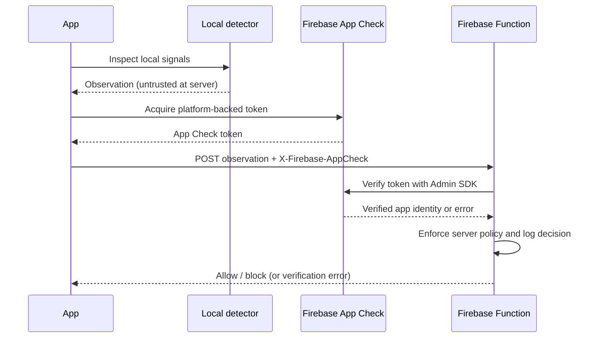

# Presenter notes

Complete the [modular Firebase setup guide](FIREBASE_SETUP.md) before teaching. It separates project setup and debug-provider exercises from API deployment and real attestation, with acceptance checks for each stage.

Suggested duration: 60–75 minutes. Prepare an attendee Firebase project, a physical Android/iOS test device, and an internet connection. Preflight both platform build tools and the native detection plugin. Firebase cloud deployment requires Blaze billing; the app can still demonstrate local detection, App Check, and Crashlytics without deploying the API.

## 1. Setup (20 minutes)

- Start in local mode. Walk through the detector, controller, and dashboard.
- Copy `.env.example` to `.env`; explain that these JSON values are compiled public configuration, not a secret store.
- Register native apps and add attendee-owned Firebase configuration files. Enable Firebase in `.env`.
- Register an App Check debug token. Explain explicitly that a debug token bypasses real attestation. Never project its value on a workshop screen.
- Check Crashlytics collection and symbols before teaching the crash exercise.

## 2. Test (20 minutes)

- Run security check. Explain `clear` means “no selected signals detected”, not “proven safe”. Developer options, debugging, proxying, and emulation alone do not trigger the local jailbreak block in this module.
- Tap **Simulate jailbreak** and **Simulate root**. Both run the real controller/reporting path with marked synthetic findings. They do not jailbreak or root the device. End the simulation to rerun native detection.
- Inspect a simulated non-fatal report and its `simulated=true` marker. Never count simulation findings as attacks in dashboards.
- Use the non-fatal test and then the intentional native crash. Reopen without reinstalling and inspect Crashlytics after delivery. Disconnect the iOS debugger before testing.
- Explain why Crashlytics is diagnostics rather than an exhaustive security audit log. Logging can fail or be tampered with; reporting errors do not suppress the block screen.

## 3. Server-owned decisions (20–35 minutes)

- Deploy `functions/` to a workshop Firebase project. Set accepted Firebase app IDs, copy the function URL to `.env`, rebuild, and repeat the flow.
- Follow the Dio interceptor: obtain current token, attach `X-Firebase-AppCheck`, send evidence, parse a strict decision. It prevents forwarding attestation to other origins or redirects.
- Follow the function: verify JWT with Admin SDK, check Firebase app ID, validate payload, evaluate policy, write a structured server log, return decision.
- Demonstrate missing/invalid tokens with the backend unit tests. These must reject before policy evaluation.
- Review `functions/policy.js`: changing this policy does not require a mobile release. Explain that the boolean supplied by the device remains untrusted.

## Explain the Frida limitation accurately

A runtime hook can replace a local detector result with `false`. Moving that same boolean into an API request does not make it trustworthy. The server sees the falsified value.

App Check introduces a separately issued attestation token backed by platform providers. Your API verifies its signature, issuer/audience/expiry, and accepted app identity through Firebase Admin SDK. App Check helps reject unauthorized clients; it does not guarantee all runtime hooks or all rooted devices are detected, and a valid token has a lifetime.

The teaching progression is:

The local guard can immediately show the block screen while submission continues. The definitive protection for data is authorization and integrity policy applied at the API for every protected operation. A hooked client can also change its own UI; it must not be able to make the API return protected data without passing server checks.

## Completion checklist

- Attendee can build local mode without committed Firebase project files.
- Real findings and synthetic findings can be distinguished.
- Crashlytics non-fatal and fatal tests are visible in the attendee project.
- Native App Check acquisition works, and the deployed API verifies tokens.
- Invalid/missing tokens, unknown local results, API outages, and malformed decisions do not grant access.
- Attendee can explain why local-only detection, debug providers, and a client-controlled boolean are insufficient for production enforcement.
